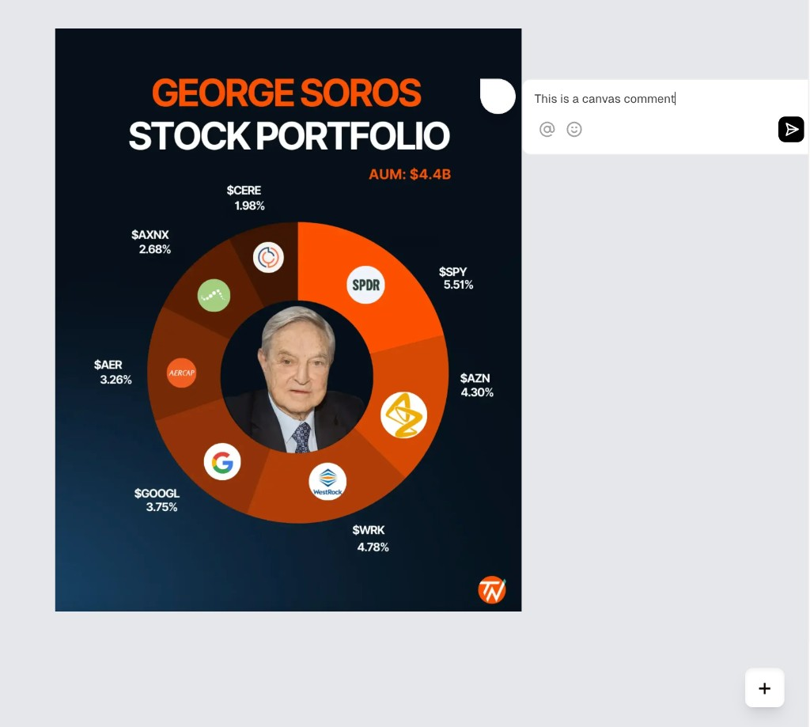
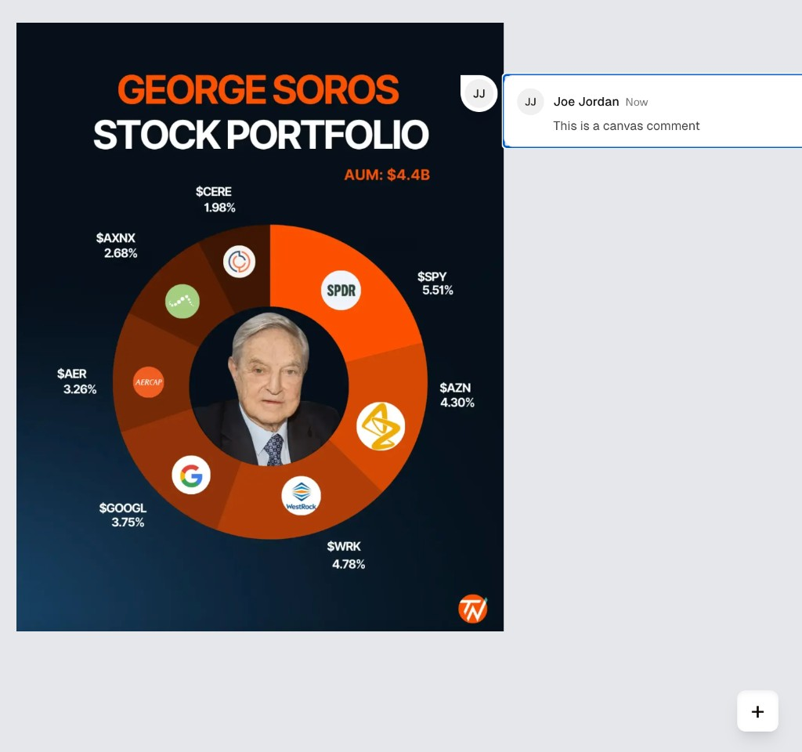

# Image Comments

Figma-style commenting on an image, built on the Liveblocks [`nextjs-comments-canvas`](https://github.com/liveblocks/liveblocks/tree/main/examples/nextjs-comments-canvas) example. Click the image to comment, drag to pan, zoom with the wheel or the controls. Comments sync in real time.

## Setup

Requires Node.js 20.19+, 22.12+ or 24+ (the minimum for Vite, which Vitest runs on).

1. **Install**

   ```sh
   npm install
   ```

2. **Add your Liveblocks key.** Copy the template and paste your secret key from the [Liveblocks dashboard](https://liveblocks.io/dashboard/apikeys):

   ```sh
   cp .env.example .env.local
   ```

   ```
   LIVEBLOCKS_SECRET_KEY=sk_dev_...
   ```

   `.env.local` is gitignored. The key is only read by the server-side auth route (`src/app/api/liveblocks-auth/route.ts`).

3. **Run**

   ```sh
   npm run dev
   ```

   Open http://localhost:3000. Open a second window to see comments sync.
   - Click the image to start a comment. Escape or clicking elsewhere cancels.
   - Drag to pan. Use the mouse wheel, trackpad pinch or the −/+ controls to zoom. Reset returns to 100%.

4. **Test**

   ```sh
   npm test
   ```

   Runs the Vitest unit tests in `src/lib/coords.test.ts`: coordinate conversion and clamping, zoom around the cursor, wheel zoom factors, and which side a thread opens on.

## Architecture decisions

- **Anchors are normalized image coordinates.** Each thread stores `{ x, y, zIndex }` in its Liveblocks metadata, where `x` and `y` run from 0 to 1 across the image. A comment stays on the same spot of the image for every viewer, screen size and zoom level. `clientToImage` converts a click using the image's `getBoundingClientRect()`, which already includes pan and zoom.
- **Pan and zoom are local UI state.** `useCanvasTransform` holds `{ x, y, scale }` per viewer and is never synced. It is applied as one CSS transform, `translate(x, y) scale(s)`, on a "world" element that contains both the image and the pins, so pins move with the image without any per-pin math.
- **Pins keep a constant size.** Each pin is placed at `left: x%`, `top: y%` inside the world and counter-scaled with `scale(1 / scale)` from its tip, so the tip stays on its anchor while the pin itself doesn't grow or shrink.
- **Zoom keeps the cursor point fixed.** `zoomAtPoint` solves for the new translation so that the point under the cursor stays put. The world is centered with flexbox, so cursor positions are measured from its untransformed layout position. Wheel zoom uses a native listener with `{ passive: false }` so it can prevent page scrolling, and each wheel event is capped at 2× so a single event can't make a huge jump.
- **One pointer pipeline separates clicks from drags.** The viewport captures the pointer on `pointerdown`. Moving more than 5px makes it a pan. A `pointerup` without a pan, on a press that started on the image, opens a new comment. Pins stop propagation, so pressing a pin never pans.
- **Threads open inwards near the right edge.** `useFlipSide` measures the space from the pin to the right edge of the image or of the viewport, whichever is closer. If that space is less than 366px (350px popover + 16px offset and padding), the thread opens to the left. A comment near the image's right edge opens inwards over the image, as the brief asks, and a thread never runs off-screen when the image is wider than the window. It updates on pan, zoom and resize.
- **Drafts are local until submitted.** A new comment is a local `{ x, y }` draft (one at a time). `createThread` runs only on submit, after the body is validated.
- **Pure logic lives in `src/lib`** with no React imports, which keeps it unit-testable. Hooks are in `src/hooks`, and components stay small.
- **Errors are visible and handled.**
  - A skeleton shows while the image loads. If it fails, an error appears with Retry. Comments only render once the image has loaded.
  - A banner reports connection loss and recovery, using `useStatus` and `useLostConnectionListener`.
  - An error boundary around the Suspense boundary offers Retry, which reloads the page.
  - Empty comments are rejected before `createThread` is called.
  - Failed saves show a notice. It comes from `useErrorListener`, and network failures are turned into error responses so they show it too.

## Out of scope

- **Moving existing comments.** The starter's drag-to-move (dnd-kit) was removed so that dragging always pans.
- **Retrying a failed save.** A failed comment shows a notice, but the text isn't kept. It has to be placed and typed again.
- **Real authentication.** The starter's demo auth assigns a random user from a fixed list on each page load, so after a reload you are usually a different user. Editing and deleting through Liveblocks' built-in comment menu only works on your own comments, so comments from an earlier session usually can't be edited after a reload.
- **Multiple images or image upload.** The canvas shows one sample image.
- **Touch pinch-zoom and keyboard shortcuts.** Touch can pan, but zoom uses the wheel, trackpad or controls. Placing a comment requires a pointer.
- **Pan limits.** The image can be panned off-screen. Reset brings it back.
- **Narrow screens.** The image scales with the window, but the 350px thread popover isn't adapted for small phones.
- **Component and end-to-end tests.** Only the pure math in `src/lib/coords.ts` is unit-tested.

## AI usage

**Tools**

- **Claude (chat), for planning and review.** I used it to break the brief into steps, discuss the coordinate model and the pan/zoom approach, draft the prompt for each step, review the code, and tighten wording in this README.
- **Claude Code, for implementation and review.** It wrote most of the code one step at a time, following the rules in `CLAUDE.md`, and reviewed staged diffs before I committed.
- **Codex, for targeted implementation help and a second review.** I used it to review staged diffs, implement focused fixes found during review, extend the coordinate and zoom tests, and re-check the tests and build before committing.

**How I worked**

- One step per prompt, with the scope stated in the prompt. Each step ended with a summary of the changes. I tested it in the browser, read the diff, then staged and committed.
- The Liveblocks starter is its own commit, so my changes are easy to tell apart from the example.
- Bugs found after a commit got a new `fix:` commit. I never amended or rewrote pushed history.

**What the AI got wrong / what I changed**

- **Pointer capture regression.** To make image clicks work, it moved `setPointerCapture` to after the 5px drag threshold. Reviewing the diff showed that if the pointer left the window before moving 5px, `pointerup` was never received and the pan got stuck. I had it keep capture on `pointerdown` and detect image clicks on `pointerup` instead.
- **A Retry that didn't really retry.** In the first version, the error boundary's Retry only called `resetErrorBoundary`, which renders the same components again. Liveblocks caches a failed threads load for 5 seconds, so pressing Retry within that window threw the cached error again and showed the same error screen. I changed Retry to reload the page.
- **It committed without being asked.** Early on it made a commit by itself. I had it undo the commit (nothing was lost). From then on every commit went through my review, and since `d26dbe9` I stage and commit myself, apart from one commit-message fix I asked it to make.
- **My project rules got lost.** Next.js generated its own `CLAUDE.md` containing only `@AGENTS.md`, and I committed that version while `AGENTS.md` was gitignored, so a fresh clone had no rules. I fixed it with a separate `fix:` commit instead of rewriting history.

**Decisions I kept out of AI hands**

- **Scope:** I removed pin dragging (dnd-kit) because the brief doesn't ask for it and it competed with panning.
- **Dependencies:** nothing new without my approval. Vitest is the only addition.
- **Commits:** none without my review. Since `d26dbe9` I make them myself.

---

# Full Stack Developer Case Study

Thank you for taking part in our hiring process. This case study is the second stage. It has one required coding task (Part B) and one optional written task (Part A).

**Deadline:** please submit within **72 hours** of receiving this link.

# Rules

1. **AI tools are allowed.** You may use any AI coding tools you like (Copilot, Cursor, Claude, ChatGPT and similar). The team you would join uses AI every day. What matters is that the result is good and that you understand it.
2. **You will explain it live.** If you move to the next stage, you will walk the team through your code and explain your decisions, line by line if asked. Only submit code you can fully explain, whoever or whatever wrote it.
3. **Add an AI usage note.** In your README, add a short section called "AI usage" covering: which tools you used, what you used them for, and at least one thing the AI got wrong or that you changed, and why.
4. **Commit in small steps.** Make regular commits with clear messages as you work. Your commit history helps us see your process.
5. **Partial is fine.** Focus on doing the core features well. A clean, working subset beats a rushed, complete one.

# Part B: Image Commenting App (Required)

Build a React app that lets users add comments to an image on a canvas, similar to commenting in design tools like Figma. Use [Liveblocks](https://liveblocks.io/docs) as the real time collaboration layer.

## Starter code

Start from the official Liveblocks canvas comments example:
[Liveblocks Canvas Comments Example](https://github.com/liveblocks/liveblocks/tree/main/examples/nextjs-comments-canvas)

Clone it, run `npm install` and `npm run dev`, and build from there.

**Liveblocks key:** the example needs a Liveblocks API key. Create a free account at [liveblocks.io](https://liveblocks.io), copy your secret key from the dashboard, and follow the example's README to add it to `.env.local`. Do **not** commit your key.

## Core features

**1. Image comments**

- Click anywhere on the image to add a comment anchored to that exact spot.
- Comment threads flip between left and right alignment based on position. If a comment is too close to the right edge of the image, it should open inwards.
- Comment positions must stay correct at every zoom level, so each comment stays on its original anchor point.

**2. Canvas interactions**

- Drag the image to pan.
- Zoom in and out controls.
- Comments keep their position relative to the image while panning and zooming.

## Optional features

- Responsive design for different screen sizes.
- Editing existing comments.

## Design reference

Use these as a guide. Working functionality matters more than matching the design exactly.






You may improve the design or add libraries if they help usability. Any icon library is fine.

## How we evaluate

Since AI tools are allowed, we care most about the quality of your decisions: how the code is structured, how you solved the hard parts (comments staying anchored through zoom and pan, the left and right flip), how you handle errors, and how well you can explain all of it.

- **Functionality:** does the app work as expected?
- **Code quality:** is the code organised, clean, maintainable and testable?
- **State management:** is state handled efficiently across components?
- **Error handling:** how does the app behave when things go wrong (for example a failed connection, an empty comment, or an image that does not load)?
- **UI and UX:** is the experience thoughtful and easy to use?

**Time expectation:** about 4 hours.

# Part A: Product Thinking (Optional)

This part is optional. Complete it if you have time. It is a good chance to show how you think about building the right thing, not just building things right.

Write your answer in `RESPONSE.md`. No code is needed. Expect about 60 to 90 minutes.

## The request

A customer of a content review platform has asked for this feature:

> "Users should be prevented from submitting for review until all AI suggestions have been actively reviewed and given a response."

## Product context

The platform helps teams prepare content before it goes to a human reviewer for approval. A typical flow:

1. A user creates or edits a piece of content.
2. The platform's AI generates suggestions about issues in that content.
3. The user can look through those suggestions.
4. The user submits the content for human review.

Today, users can submit for review without explicitly responding to the AI suggestions.

You have also heard from three stakeholders:

- One says users skip obvious AI suggestions, which creates unnecessary review rounds.
- Another wants a clearer audit trail showing that suggestions were considered.
- A third worries that a blanket rule will add friction and slow people down.

## Your task

Answer three things in `RESPONSE.md`:

1. **Questions you would ask.** What would you ask the customer or internal stakeholders to understand the problem and avoid building the wrong thing?
2. **How you would learn more without them.** The customer is unavailable for a week. What data, product behaviour, people or other sources would you look at to reduce uncertainty?
3. **A developer ready ticket.** Write the ticket you would hand to engineering. It should be specific enough to estimate and start work, and should clearly list open questions, assumptions and dependencies.

You do not need to design the UI in detail. Make reasonable assumptions and label them clearly. We care more about your thinking than finding one correct answer.

# How to submit

1. Click **Use this template** at the top of this repository to create your own copy (or clone it).
2. Build Part B in your repository, and add setup instructions to your README so we can run it in a few minutes.
3. If you do Part A, write it in `RESPONSE.md`.
4. Push your work to your own GitHub repository. If it is private, give access to this GitHub account.
5. Email the link to **info@limitlessoutsourcing.com** with the subject "Case Study: Your Full Name".

Good luck. We look forward to seeing your work.

Limitless Outsourcing Team
